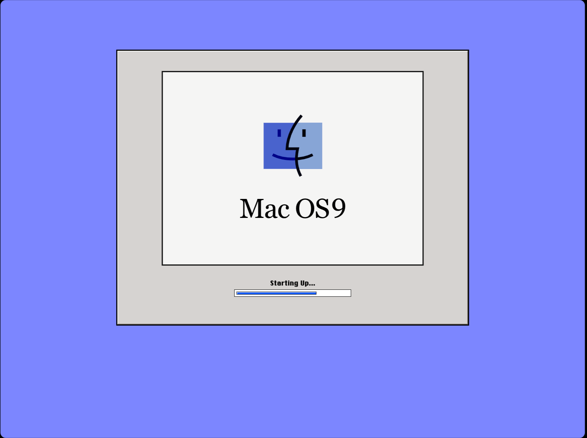
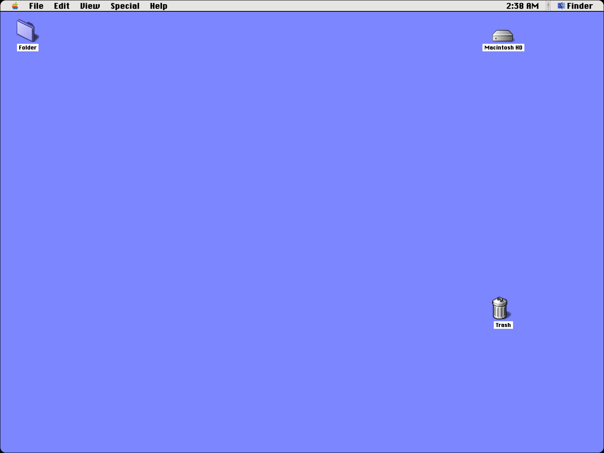
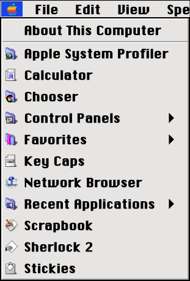
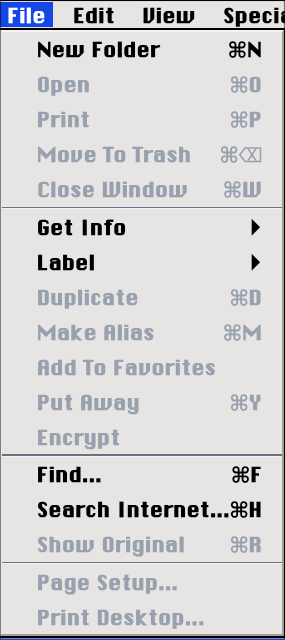
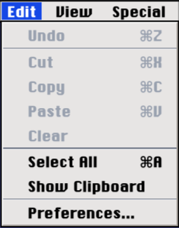
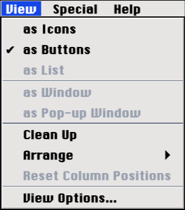
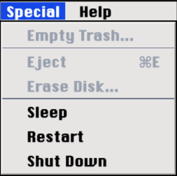
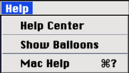

# Mac OS 9 | [Live demo](https://mac-os-9.vercel.app/)

### This is a recreation of the **Mac OS 9** in **TSX** _(TypeScript + JavaScriptXML)_, not some emulator so the boot screen is just hardcoded to be a random time.



## Why I made this

I mostly made this just because i was bored, i was sitting in class and i just got an idea to make a site, then spent like an hour trying to figure out what to make.

first i wanted to make an interactive DJ Console, also in TSX, then gave up after learning i would have to make the potentiometers and the markers ( on the knob theres like little dots showing what % is the potentiometer turned to ), so i just gave up, after giving up i had another idea, also gave up on it.

then i clicked on an emulator of mac os 1 or the macintosh, and so i wanted to recreate it, but maybe a bit younger version because it was REALLY laggy, so i chose the Mac OS 9, then found an emulator for it [Mac OS 9 EMU](https://infinitemac.org/2000/Mac%20OS%209.0.4)

im kinda trying to flex on the people who only ship projects like a calculator, while i built a system that has a calculator in it.

i also already had some experience making a web 'OS' ( recreated Windows 7 ). I wouldn't say it's as good as this project, but still, it's something.

## Stack

<p align="left">
  
  
  
  
</p>

**Nice problem i had:**

- There was one problem, Window Sizing and Position, because earlier, you could just drag the window out the screen, or just make it big enough to go outside the screen ( window sizing ), this problem exists because older versions on mac os, ( Apple computers ), had screens that where taller, ( in ratio width:height ), and i couldnt just made the screen taller, it would stick out the screen, so i just made it less wide, that created the problem that windows could still stick out that margin, so i had to take the position of the window relative the the fake screen, take the width of the window, and the width of the fake screen,

- `if ( window.xPos + window.width >= fakeScreen.width ) { block moving right, or making the window wider }` and this just totaly fixed the problem, yay

## Screenshots









## How to run it

1. Clone the repo

```sh
git clone https://github.com/SandwichEater577/macOS-9 && cd macOS-9
```

2. Install dependencies

```sh
npm install
```

3. Start the dev server on `localhost:5173`

```sh
npm run dev
```

After running the server start command, this should appear:

```sh
> macos-9@0.0.0 dev
> vite

  VITE v8.3.6  ready in 366 ms

  ➜  Local:   http://localhost:5173/
  ➜  Network: use --host to expose
  ➜  press h + enter to show help
```

click the link and it will open in your default browser.

4. Build to `/dist`

```sh
npm run build
```

## AI disclosure

- Couldnt find good icons, asked DeepSeek to find icons used in Mac OS 9
